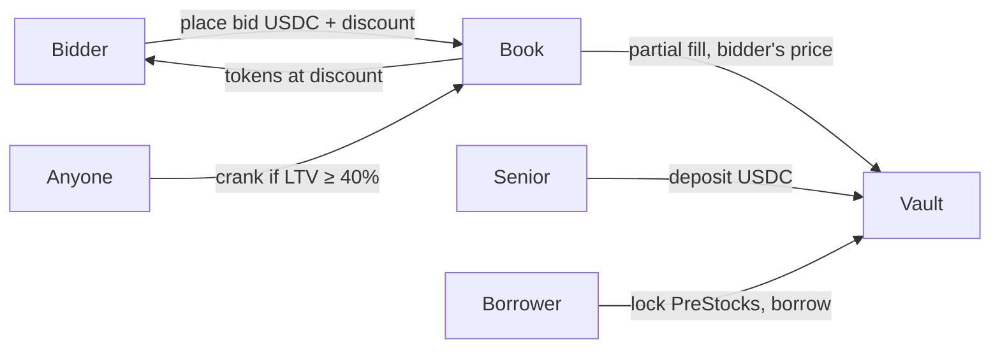

# Catch architecture (v1.2)

Lending, the bid book, and liquidation are **the same on-chain program**.

| | Role |
|---|---|
| **Senior vault** | USDC that is lent out. Earns a scarcity-weighted share of interest (5% floor). |
| **Bid book (yNFTs)** | USDC escrowed at a chosen discount. Never lent. This sum **is** the market ceiling. |
| **Borrower** | Locks PreStocks, takes USDC ≤ 30% LTV. Position health is a loan NFT (Chad VC → Rekt). |
| **Reserve** | 10% of gross interest, per market, first-loss after junior bids. |



## Ceiling

```
market ceiling = USDC locked in the bid book
```

No bids → no loans. New debt + N days of interest must stay under the book.

## Rates

Kinked on senior utilization: 10% → 15% at 80% → 30% full. Net of a 10% reserve factor, interest splits toward whichever side is scarcer. Lock yield goes only to engaged bids (price–time prefix that covers open debt).

## Liquidation

Atomic and **partial**. One crank sells only enough collateral to restore 30% LTV, filling yNFTs lowest-discount-first. No DEX sale. Borrower NFT stays Chad / Anxious / McPepe if the loan remains open; Rekt only after a full close (dust or insolvent).

## Health art

Loan NFT bands are unchanged: **Chad VC** &lt; 30% → Anxious 30–35% → McPepe 35–40% → Liquidatable ≥ 40% → **Rekt** after on-chain close.
