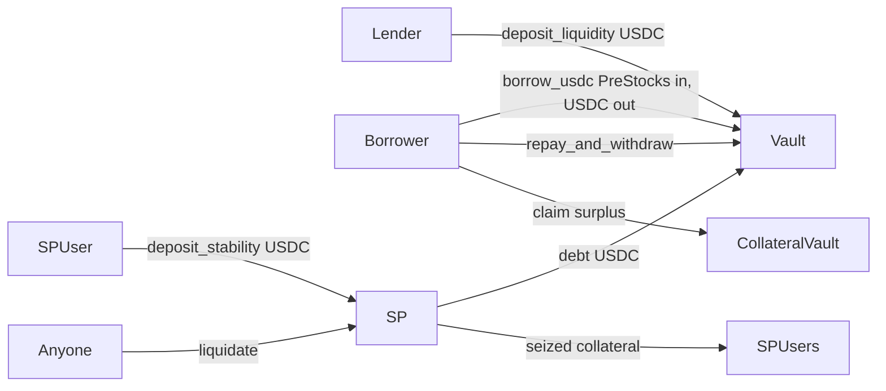

# PreLend architecture

Lending, the Stability Pool, and liquidation are **the same on-chain program**.

| Program | Address / id | Role |
|---|---|---|
| **PreLend** | `HujDemHxNw2y7qJSDrgE1eYhVS8SGTvQL55oweQfNQfd` | Vaults, LTV, Stability Pool, liquidation |
| **SPL Token / Token-2022** | `Tokenkeg…` / `TokenzQd…` | Move USDC and PreStocks |
| **PreStocks tokens** | e.g. `Pren1FvF…` (ANTHROPIC) | Collateral mints |
| **PreStocks API + DEX TWAP** | posted on-chain | Restricted-mode oracle |

The protocol itself never swaps on a DEX. Liquidations are absorbed by a pre-funded Stability Pool (or an external liquidator). See [`DEPLOY.md`](DEPLOY.md).

## Roles



- **Lender** supplies USDC to the lending vault.
- **Borrower** locks PreStocks, takes USDC ≤ max LTV, pays 12% APR.
- **Stability Pool depositor** pre-funds USDC to buy liquidated collateral at a ~10% bonus.
- **Anyone** can liquidate an underwater position.

## Restricted-mode parameters (Day-0)

| Param | Value |
|---|---|
| Max borrow LTV | 30% |
| Liquidation LTV | 40% |
| Liquidation bonus | 10% |
| APR | 12% |
| Admin debt cap | 25,000 USDC |
| Staleness | 300s |
| SP withdraw | instant (USDC + claim tokens) |
| Demo asset | ANTHROPIC |

Debt after a borrow must stay under `min(admin_ceiling, Stability Pool USDC + posted DEX depth)`.

## Liquidation (worked example)

```
Price $1,000. Deposit 10 ANTHROPIC ($10,000), borrow $3,000 → LTV 30% (restricted max)
Price falls to $750 → value $7,500 → LTV 40% → liquidatable

seize   = 3,000 × 1.10 / 750 = 4.4 tokens
surplus = 5.6 tokens → returned to borrower
Stability Pool: −$3,000 USDC, +4.4 tokens
Lender vault:   +$3,000, made whole
```

Class A (when a Pyth key is available): 40% borrow LTV / 50% liquidation. Example at $1,000: deposit 10 tokens ($10,000), borrow $4,000; at $800 seize 5.5, surplus 4.5.

## Staleness policy

Blocked when a required source is stale: borrow, collateral withdrawal, Stability Pool deposit, liquidation.

Kept open: repay, collateral deposit, lender deposit/withdraw, Stability Pool claim after cooldown.

## Oracle panel (UI)

Shows PreStocks markPrice, posted DEX TWAP, which `min()` is used, market class (restricted), staleness, and the debt-cap breakdown (pool USDC + depth). Pyth Index feed id is displayed as gated until a `pyth-indices` key exists.
